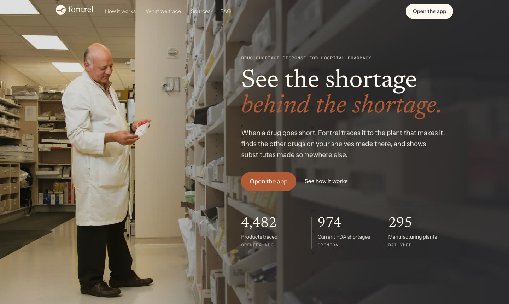
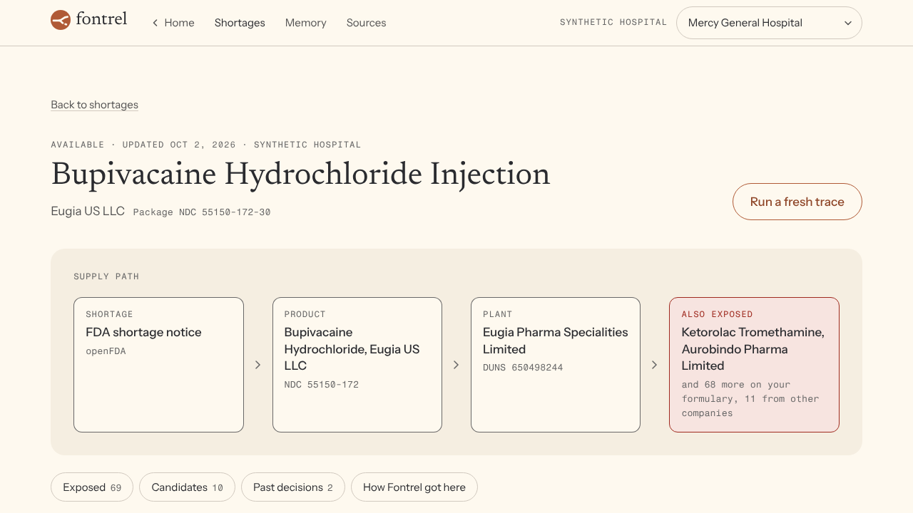
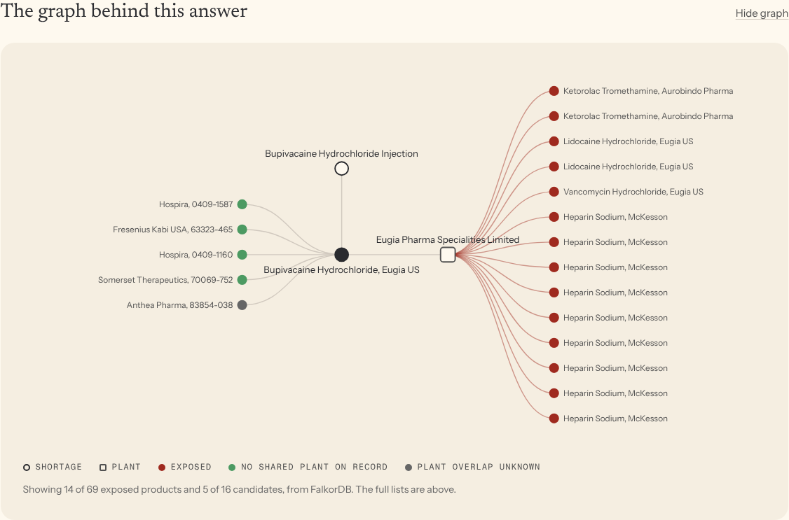

# fontrel

**See the shortage behind the shortage.**

When a drug goes short, a hospital pharmacy usually finds out one product at a time. Fontrel follows the shortage to the plant listed on the drug's FDA label, finds the other products on your formulary made at that same plant, and lists candidate alternatives with no plant in common. A pharmacist approves or rejects each one, and Fontrel remembers that decision the next time the same drug is short.

It runs on a [FalkorDB](https://www.falkordb.com/) graph built from public FDA data.



## A real example

On October 16, 2026, Eugia US bupivacaine injection (NDC 55150-249) was on the FDA shortage list. Its FDA label lists one manufacturing plant: Eugia Pharma Specialities Limited (DUNS 650498244).

That same plant also makes products sold under other company names, including Aurobindo ketorolac and McKesson SKY heparin. Neither had a shortage notice. That isn't proof they will run short, but it is shared exposure worth a look. A shortage list shows you the bupivacaine. The graph shows you the ketorolac and heparin too.

You can check this yourself: open the [ketorolac label on DailyMed](https://dailymed.nlm.nih.gov/dailymed/drugInfo.cfm?setid=007a4da5-d794-416c-94b3-6ee9e7842c52) and look at the establishment section.



## What it does

1. **Trace the plant.** Reads the shortage, then walks from the product to the plant listed on its FDA label.
2. **Find what else is exposed.** Finds every product on the hospital's formulary made at that plant, flagging the ones that have no shortage notice yet.
3. **List candidate alternatives.** Finds products from other companies with the same ingredients at the same strengths, the same form and the same route. Each candidate shows that evidence and its label link, and falls into one of three groups: no shared plant on record, shares a plant, or plant overlap unknown (when either label lists no plant). These are candidates for review, not confirmed therapeutic equivalents.
4. **Remember decisions.** A pharmacist approves or rejects a candidate. The decision is saved in that hospital's own graph. On the next trace, candidates the team rejected before are listed lower, past approvals are shown with their outcome, and the agent recalls them.
5. **Show its work.** Every step lists the Cypher query it ran, how many rows came back, and how long it took.

The app has four screens: a shortage inbox, the trace for one shortage, the hospital's decision memory, and a ranking of the plants that the most products depend on.

## Tracks

- Agents That Act on Connected Data
- Agent Memory and Coordination

## Run it locally

This takes about 10 minutes on a fresh machine. Most of that is the first data download.

### What you need

| Tool | Version | Get it |
|---|---|---|
| Docker | Any recent version, with Docker Compose | [docker.com/get-started](https://www.docker.com/get-started/) |
| Python | 3.11 or newer | [python.org/downloads](https://www.python.org/downloads/) |
| Node.js | 20 or newer | [nodejs.org](https://nodejs.org/) |
| Groq API key | Optional, free | [console.groq.com/keys](https://console.groq.com/keys) |

Without a Groq key the app still works. Every list, path and graph comes from FalkorDB. You just won't get the short written summary at the top of each trace.

### Steps

Run these from a terminal. On Windows, use WSL or Git Bash. The one Windows-specific difference is noted in step 3.

**1. Get the code and start FalkorDB**

```bash
git clone https://github.com/mystiquemide/fontrel.git
cd fontrel
docker compose up -d
```

FalkorDB now runs on port 6379, reachable only from your machine. Its browser UI is at http://localhost:3000 if you want to look at the graph directly.

**2. Add your settings**

```bash
cp .env.example .env
```

Open `.env` and paste your Groq key after `GROQ_API_KEY=`. Leave it empty to run without the written summary.

**3. Install the backend**

```bash
python3 -m venv .venv
source .venv/bin/activate
pip install -r backend/requirements.txt
```

On Windows PowerShell, activate with `.venv\Scripts\Activate.ps1` instead.

**4. Load the data**

```bash
cd backend
python -m ingest.run
python -m ingest.synth
```

`ingest.run` downloads current FDA data and builds the supply graph. It takes about two minutes and caches the files in `data/raw`, so later runs are faster. To pull fresh data later, run `python -m ingest.run --refresh`. Shortages that have left the FDA list are removed on each load. `ingest.synth` creates the two synthetic hospitals.

**5. Start the API**

```bash
uvicorn fontrel.api:app --port 8000
```

Leave this running. Check it at http://localhost:8000/api/health.

**6. Start the app** (in a second terminal)

```bash
cd fontrel/frontend
npm install
npm run dev
```

Open http://localhost:3100. Select **Open the app**, then select **Trace** on any shortage.

### If something goes wrong

| What you see | What to do |
|---|---|
| `Cannot connect to the Docker daemon` | Start Docker Desktop, or run `sudo systemctl start docker` on Linux, then run `docker compose up -d` again. |
| The API says `falkordb: false` | FalkorDB isn't running. Run `docker compose up -d` from the project folder. |
| The app shows "Fontrel cannot reach its graph database" | The API isn't running. Start it as in step 5. |
| The inbox shows no shortages | The data isn't loaded. Run step 4. |
| Traces say "The AI model is busy" | No Groq key, or you hit Groq's free rate limit. The lists still come straight from the graph. Wait a minute and select **Run a fresh trace**. |
| `Port 8000 is already in use` | Start the API on another port, for example `--port 8001`, and start the app with `BACKEND_URL=http://localhost:8001 npm run dev`. |

### Run the tests

```bash
cd backend
python -m pytest -q
```

65 tests run against the live graph. They cover data loading, strength matching, every query, tenant separation, the agent's guardrails, the trace cache and the API.

## How it works

```
Browser (Next.js) ──▶ FastAPI ──▶ agent loop ──▶ read-only graph tools ──▶ FalkorDB
                          │                                                   ▲
                          └──── approve / reject (the only write) ────────────┘
```

- **Backend:** Python and FastAPI. Traces stream to the browser step by step as server-sent events.
- **Agent:** a plain tool-calling loop on an OpenAI-compatible API, using Groq's `openai/gpt-oss-120b`. The model chooses which graph tools to call. The tools are read-only, and the hospital is bound on the server, so the model can't query another hospital's graph.
- **Required steps:** the exposure, candidate and memory queries always run. If the model answers early, the server runs whatever it skipped before the trace is complete.
- **Answer checks:** each list in the model's answer is checked against the query that owns it. An exposed product must come from the exposure query and a candidate from the candidate query, and a candidate's status always comes from the graph, never from the model. Anything else is dropped. The written summary is labeled as the model's.
- **No model? No problem:** if the model is unavailable, the same queries run in a fixed order and the answer is built straight from the graph.
- **Cache:** complete traces are saved in the hospital's graph and replayed until that hospital's decisions change or the data is reloaded.
- **Limits:** at most two fresh traces run at once (`MAX_FRESH_TRACES`), never two for the same shortage, and a trace stops if the browser leaves.
- **Frontend:** Next.js and Tailwind.

## Graph data model

Fontrel uses one shared graph for public data and one graph per hospital. The hospital graphs never query each other. They join to the shared graph on product NDC.



### Shared graph: `supply`

| Node | Key properties | Source |
|---|---|---|
| `Product` | `product_ndc`, `generic_name`, `labeler`, `dosage_form`, `route` | openFDA NDC directory |
| `Ingredient` | `name` | openFDA NDC directory |
| `Labeler` | `name` | openFDA NDC directory |
| `Site` | `duns`, `name` | DailyMed label establishments |
| `Supplier` | `name` | FDA Drug Master File list |
| `Shortage` | `id`, `generic_name`, `company`, `availability`, `updated` | openFDA drug shortages |
| `IngestRun` | `source`, `records`, `fetched`, `at` | When each source was downloaded and when the graph was built from it |

| Relationship | From → To | Meaning |
|---|---|---|
| `CONTAINS` | Product → Ingredient | Active ingredient |
| `LABELED_BY` | Product → Labeler | Company on the label |
| `MADE_AT` | Product → Site | Plant on the FDA label, with `operation` (manufacture, pack, label and so on) and the label `setid` |
| `MANUFACTURED_AT` | Product → Site | The `MADE_AT` links where the operation is manufacture. Used by the graph algorithms. |
| `AFFECTS` | Shortage → Product | The shortage notice covers this product |
| `EQUIVALENT_TO` | Product ↔ Product | Same ingredients at the same strength each, same form and route, different company. Products with any missing strength are never paired. |
| `CANDIDATE_SUPPLIER` | Supplier → Ingredient | A Drug Master File for the ingredient, with `dmf` number and weight 0.3. This is a registration, not confirmed supply. |

### Hospital graphs: `tenant_<id>`

| Node | Meaning |
|---|---|
| `Hospital` | The hospital |
| `FormularyItem` | A product the hospital stocks, keyed by `product_ndc` |
| `Episode` | One shortage the hospital dealt with |
| `Decision` | A pharmacist's approve or reject, with reason, name and date |
| `Trace` | A saved trace, replayed while the hospital's decisions are unchanged |

Relationships: `(Episode)-[:FOR]->(FormularyItem)`, `(Decision)-[:IN]->(Episode)` and `(Decision)-[:CHOSE]->(FormularyItem)`.

## Queries and algorithms

These are the queries the product depends on, copied from [`backend/fontrel/tools.py`](backend/fontrel/tools.py). All of them are parameterised and read-only.

**Q1. Products made at the same plant as the shortage product** (what else is exposed)

```cypher
MATCH (s:Shortage {id: $sid})-[:AFFECTS]->(p:Product)-[m1:MADE_AT {operation: 'MANUFACTURE'}]->(site:Site)
      <-[m2:MADE_AT {operation: 'MANUFACTURE'}]-(other:Product)
WHERE other.product_ndc IN $formulary AND other.product_ndc <> p.product_ndc
OPTIONAL MATCH (other)<-[:AFFECTS]-(os:Shortage)
RETURN DISTINCT other.product_ndc AS product_ndc, other.generic_name AS product, other.labeler AS labeler,
       site.name AS via_site, site.duns AS duns, m1.setid AS shortage_label_setid,
       m2.setid AS exposed_label_setid, count(DISTINCT os) > 0 AS already_in_shortage,
       [p.product_ndc, site.name, other.product_ndc] AS path
ORDER BY already_in_shortage, labeler
```

**Q2. Formulary products sharing an ingredient, with registered suppliers**

```cypher
MATCH (s:Shortage {id: $sid})-[:AFFECTS]->(p:Product)-[:CONTAINS]->(i:Ingredient)
OPTIONAL MATCH (i)<-[c:CANDIDATE_SUPPLIER]-(sup:Supplier)
WITH p, i, count(DISTINCT sup) AS supplier_count, collect(DISTINCT c.dmf)[0..5] AS sample_dmfs
MATCH (i)<-[:CONTAINS]-(other:Product)
WHERE other.product_ndc IN $formulary AND other.product_ndc <> p.product_ndc
RETURN i.name AS ingredient, supplier_count, sample_dmfs,
       collect(DISTINCT {product_ndc: other.product_ndc, product: other.generic_name,
                         labeler: other.labeler}) AS formulary_products
```

**Q3. Candidate alternatives, compared with the shortage product's plants**

```cypher
MATCH (s:Shortage {id: $sid})-[:AFFECTS]->(p:Product)-[:EQUIVALENT_TO]-(alt:Product)
OPTIONAL MATCH (p)-[:MANUFACTURED_AT]->(bad:Site)<-[:MANUFACTURED_AT]-(alt)
OPTIONAL MATCH (alt)-[am:MADE_AT {operation: 'MANUFACTURE'}]->(own:Site)
OPTIONAL MATCH (alt)<-[:AFFECTS]-(altsh:Shortage)
OPTIONAL MATCH (alt)-[ac:CONTAINS]->(ai:Ingredient)
RETURN DISTINCT alt.product_ndc AS product_ndc, alt.generic_name AS product, alt.labeler AS labeler,
       alt.dosage_form AS dosage_form, alt.route AS route, alt.spl_set_id AS label_setid,
       collect(DISTINCT {name: ai.name, strength: ac.strength}) AS ingredients,
       collect(DISTINCT bad.name) AS shared_sites,
       collect(DISTINCT {site: own.name, setid: am.setid}) AS own_sites,
       count(DISTINCT altsh) > 0 AS in_shortage
```

Two small follow-up queries supply the rest. One counts the shortage product's recorded plants. The other reads the hospital's last decision on each candidate:

```cypher
// tenant graph
MATCH (d:Decision)
WITH d.substitute_ndc AS substitute_ndc, d ORDER BY d.at DESC
WITH substitute_ndc, collect(d)[0] AS last
RETURN substitute_ndc, last.action AS action, last.reason AS reason, last.outcome AS outcome,
       last.outcome_days AS outcome_days, last.at AS at
```

Each candidate is then labeled **shares a plant** (a shared plant was found), **no shared plant on record** (both products list manufacturing plants and none overlap) or **plant overlap unknown** (either label lists no plant). Within each group, candidates the hospital rejected before are listed lower.

**Q4. Plants ranked by dependence** (PageRank)

```cypher
CALL algo.pageRank(null, 'MANUFACTURED_AT') YIELD node, score
WITH node, score WHERE node:Site
MATCH (node)<-[:MANUFACTURED_AT]-(p:Product)
OPTIONAL MATCH (p)<-[:AFFECTS]-(sh:Shortage)
RETURN node.name AS site, node.duns AS duns, score AS pagerank,
       count(DISTINCT p) AS products, count(DISTINCT p.labeler) AS labelers,
       count(DISTINCT sh) AS shortages
ORDER BY pagerank DESC LIMIT $limit
```

**Q5. Plant groups touching a formulary** (weakly connected components)

```cypher
CALL algo.WCC({nodeLabels: ['Product', 'Site'], relationshipTypes: ['MANUFACTURED_AT']})
YIELD node, componentId
WITH componentId, collect(node) AS members
WITH componentId, [n IN members WHERE n:Site | n.name] AS sites,
     [n IN members WHERE n:Product AND n.product_ndc IN $formulary | n.product_ndc] AS formulary_products
WHERE size(sites) > 1 AND size(formulary_products) > 0
RETURN componentId AS cluster, size(sites) AS site_count, sites[0..6] AS sites,
       size(formulary_products) AS formulary_count, formulary_products[0..12] AS formulary_sample
ORDER BY formulary_count DESC LIMIT $limit
```

**Q6. A hospital's past decisions for the same ingredient** (two steps: shared graph, then hospital graph)

```cypher
// supply graph
MATCH (s:Shortage {id: $sid})-[:AFFECTS]->(:Product)-[:CONTAINS]->(i:Ingredient)<-[:CONTAINS]-(r:Product)
RETURN collect(DISTINCT r.product_ndc) AS ndcs

// tenant graph
MATCH (e:Episode)-[:FOR]->(f:FormularyItem) WHERE f.product_ndc IN $ndcs
MATCH (d:Decision)-[:IN]->(e)
OPTIONAL MATCH (d)-[:CHOSE]->(sub:FormularyItem)
RETURN e.id AS episode, e.shortage_label AS episode_label, e.opened AS opened, e.closed AS closed,
       d.id AS decision, d.action AS action, d.substitute_ndc AS substitute_ndc,
       sub.generic_name AS substitute, sub.labeler AS substitute_labeler,
       d.reason AS reason, d.outcome AS outcome, d.outcome_days AS outcome_days,
       d.synthetic AS synthetic, d.by AS by, d.at AS at
ORDER BY e.opened DESC, d.id
```

The only write in the product is a pharmacist's decision, `POST /api/decisions`. It uses `MERGE`, so saving the same decision twice updates one node instead of creating two.

## API

| Method | Path | What it returns |
|---|---|---|
| GET | `/api/health` | Database status, node counts, and when each source was downloaded and loaded |
| GET | `/api/tenants` | The hospitals |
| GET | `/api/shortages?tenant=` | Current FDA shortages on that hospital's formulary |
| POST | `/api/trace` | A trace, streamed step by step |
| GET | `/api/graph/subgraph?tenant=&shortage_id=` | Up to 25 nodes for the graph view |
| POST | `/api/decisions` | Saves an approve or reject |
| GET | `/api/recall?tenant=&shortage_id=` | The past decisions a trace would recall |
| GET | `/api/memory?tenant=` | Every episode and decision for a hospital |
| GET | `/api/sources?tenant=` | The PageRank plant ranking and the plant groups |
| GET | `/api/ingredients` | Shortage and supplier counts per ingredient |
| GET | `/api/anchor?tenant=` | A current shortage with exposure across companies |

## Project layout

```
backend/
  fontrel/    API, agent loop, graph tools, trace cache
  ingest/     data loaders for openFDA, DailyMed and the DMF list, plus the synthetic hospitals
  tests/      65 tests against a live FalkorDB
frontend/
  src/app/        landing page and the app screens
  src/components/ shared header, logo and landing sections
docker-compose.yml  FalkorDB with append-only persistence, bound to localhost
```

## Data

| Source | Used for | Notes |
|---|---|---|
| [openFDA drug shortages](https://open.fda.gov/apis/drug/drugshortages/) | Current shortages | Public, no key needed |
| [openFDA NDC directory](https://open.fda.gov/apis/drug/ndc/) | Products, ingredients, labelers | Public |
| [DailyMed](https://dailymed.nlm.nih.gov/dailymed/) | Manufacturing plants from each label's establishment section | Public. Not every label lists its plants. |
| [FDA Drug Master File list](https://www.fda.gov/drugs/drug-master-files-dmfs/list-drug-master-files-dmfs) | Registered ingredient suppliers | Public. Registrations, not confirmed supply, and the list has no country column. |

Fontrel tracks 38 ingredients that hospitals often see in shortage, including bupivacaine, lidocaine and heparin. The list is in [`backend/ingest/drugs.yaml`](backend/ingest/drugs.yaml). The data was loaded on October 16, 2026, and counts change slightly whenever it is reloaded.

**The two hospitals, Mercy General and Lakeside Community, are synthetic.** Their formularies and past decisions were generated for this project and are labeled synthetic in the app. No patient or hospital data is used.

## Limits

- Fontrel supports a pharmacist's decision. It doesn't choose a drug or a dose, and a candidate alternative is not a confirmed therapeutic equivalent. The FDA [Orange Book](https://www.fda.gov/drugs/development-approval-process-drugs/orange-book-preface) sets that bar.
- A shared plant means shared exposure to review. It doesn't prove the plant caused the shortage or that other products will run short.
- There is no sign-in. Each hospital's data lives in its own graph and the agent only reads the hospital it was started for, but anyone using this demo can switch hospitals. A real deployment needs sign-in before each hospital's decisions are private.
- It doesn't forecast shortages. It works from what is filed today.
- Plant data is only as complete as the FDA labels. Products with no listed plant are shown as "no site on file", never as safe.
- Drug Master File suppliers are registrations. Fontrel doesn't claim anyone is actively supplying.
- It doesn't rate countries or regions, because the public data has no reliable country field.
- Groq's free tier allows about one fresh trace per minute. Saved traces replay instantly.
- The API allows browser calls only from `http://localhost:3100` by default. Set `CORS_ORIGINS` when you deploy it elsewhere.

Fontrel works at a different layer from supply maps such as the [USP Medicine Supply Map](https://www.usp.org/supply-chain/medicine-supply-map). It takes the plant-level picture down to one hospital's formulary, proposes an action, and remembers what that hospital decided.

## Built with AI assistance

AI coding assistants were used to write and review parts of the code and documentation, under my direction. The graph model, the queries, the data checks and the product decisions are mine, and every query result shown here was checked against the live data.

At runtime, Fontrel calls `openai/gpt-oss-120b` on Groq to choose tools and write the short summary. The model never writes to the graph, and its answers are checked against graph results before they are shown.

## Credits

Photos from [Unsplash](https://unsplash.com/license) by National Cancer Institute, Árpád Czapp and Diana Polekhina. Fonts are Newsreader, Instrument Sans and Fragment Mono from Google Fonts.
